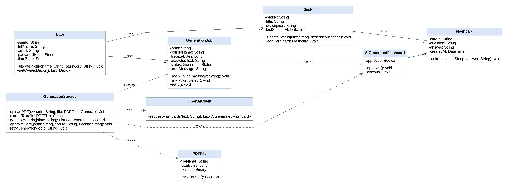

# Individual Class Model – Hanin Hamida (G00101852)

Component: **AI generation**. Use cases / requirements: UC-11–UC-15 / FR-11–FR-15. Shared classes (User, Deck, Flashcard) are shown as external dependencies and are not attributed solely to this contributor.

## Class inventory

| Class ID | Class | Purpose / responsibility | Related use case / owner |
|---|---|---|---|
| C01 | User | Registered student and profile owner | UC-01–UC-05 / FR-01–FR-05 |
| C09 | GenerationJob | PDF extraction, candidates and retry status | UC-11–UC-15 / FR-11–FR-15 |
| C10 | GenerationService | PDF extraction, generation and candidate review | UC-11–UC-15 / FR-11–FR-15 |
| C11 | PDFFile | PDF upload payload and size/type validation | UC-11–UC-15 / FR-11–FR-15 |
| C12 | OpenAIClient | External OpenAI generation interface | UC-11–UC-15 / FR-11–FR-15 |
| C07 | AIGeneratedFlashcard | AI candidate with approval state | UC-11–UC-15 / FR-11–FR-15 |
| C05 | Flashcard | Question and answer study content | UC-06–UC-10 / FR-06–FR-10 |
| C04 | Deck | Owned collection of flashcards | UC-06–UC-10 / FR-06–FR-10 |

## Class diagram

