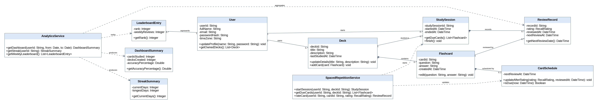

# Individual Class Model – Karam Sawas (B00100437)

Component: **Study and analytics**. Use cases / requirements: UC-16–UC-20 / FR-16–FR-20. Shared classes (User, Deck, Flashcard) are shown as external dependencies and are not attributed solely to this contributor.

## Class inventory

| Class ID | Class | Purpose / responsibility | Related use case / owner |
|---|---|---|---|
| C01 | User | Registered student and profile owner | UC-01–UC-05 / FR-01–FR-05 |
| C04 | Deck | Owned collection of flashcards | UC-06–UC-10 / FR-06–FR-10 |
| C05 | Flashcard | Question and answer study content | UC-06–UC-10 / FR-06–FR-10 |
| C13 | StudySession | User review session for a chosen deck | UC-16–UC-20 / FR-16–FR-20 |
| C14 | ReviewRecord | Per-card recall rating and review timestamp | UC-16–UC-20 / FR-16–FR-20 |
| C15 | CardSchedule | Current next-due date for a flashcard | UC-16–UC-20 / FR-16–FR-20 |
| C16 | SpacedRepetitionService | Fetch due cards and apply recall ratings | UC-16–UC-20 / FR-16–FR-20 |
| C17 | AnalyticsService | Streak, dashboard and weekly leaderboard computation | UC-16–UC-20 / FR-16–FR-20 |
| C18 | DashboardSummary | Dashboard values for selected period | UC-16–UC-20 / FR-16–FR-20 |
| C19 | StreakSummary | Current and longest streak days | UC-16–UC-20 / FR-16–FR-20 |
| C20 | LeaderboardEntry | User ranking for weekly review activity | UC-16–UC-20 / FR-16–FR-20 |

## Class diagram

