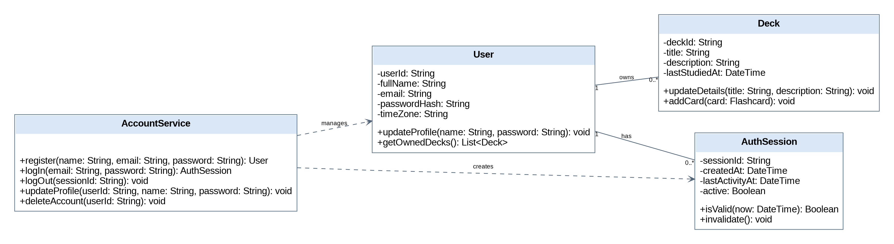

# Individual Class Model – Samer Salem (B00099718)

Component: **Accounts**. Use cases / requirements: UC-01–UC-05 / FR-01–FR-05. Shared classes (User, Deck, Flashcard) are shown as external dependencies and are not attributed solely to this contributor.

## Class inventory

| Class ID | Class | Purpose / responsibility | Related use case / owner |
|---|---|---|---|
| C01 | User | Registered student and profile owner | UC-01–UC-05 / FR-01–FR-05 |
| C02 | AuthSession | Authenticated session and inactivity state | UC-01–UC-05 / FR-01–FR-05 |
| C03 | AccountService | Registration, login, logout, profile updates and deletion | UC-01–UC-05 / FR-01–FR-05 |
| C04 | Deck | Owned collection of flashcards | UC-06–UC-10 / FR-06–FR-10 |

## Class diagram

