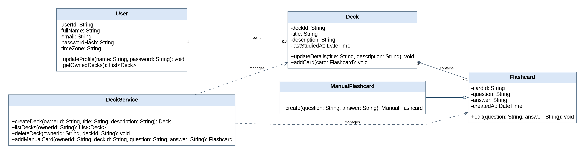

# Individual Class Model – Tarik Mamlouk (B00102420)

Component: **Decks and cards**. Use cases / requirements: UC-06–UC-10 / FR-06–FR-10. Shared classes (User, Deck, Flashcard) are shown as external dependencies and are not attributed solely to this contributor.

## Class inventory

| Class ID | Class | Purpose / responsibility | Related use case / owner |
|---|---|---|---|
| C01 | User | Registered student and profile owner | UC-01–UC-05 / FR-01–FR-05 |
| C04 | Deck | Owned collection of flashcards | UC-06–UC-10 / FR-06–FR-10 |
| C05 | Flashcard | Question and answer study content | UC-06–UC-10 / FR-06–FR-10 |
| C06 | ManualFlashcard | Manually authored flashcard specialization | UC-06–UC-10 / FR-06–FR-10 |
| C08 | DeckService | Owned deck and card operations | UC-06–UC-10 / FR-06–FR-10 |

## Class diagram

